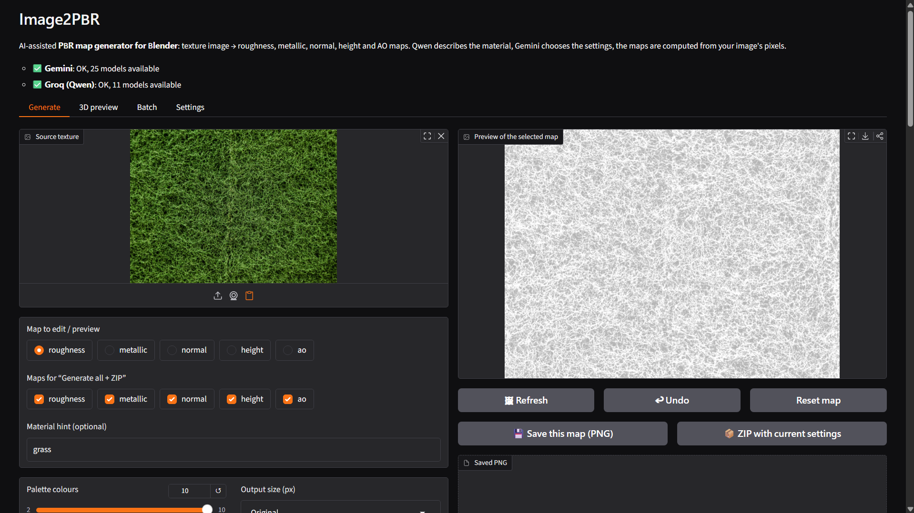
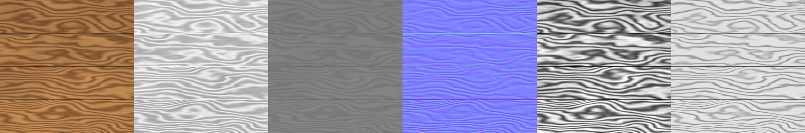
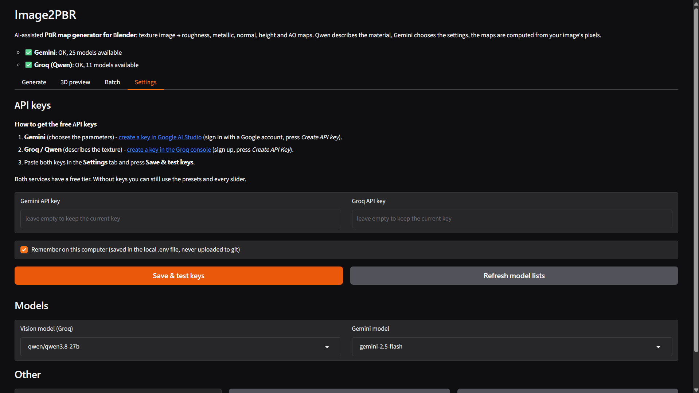
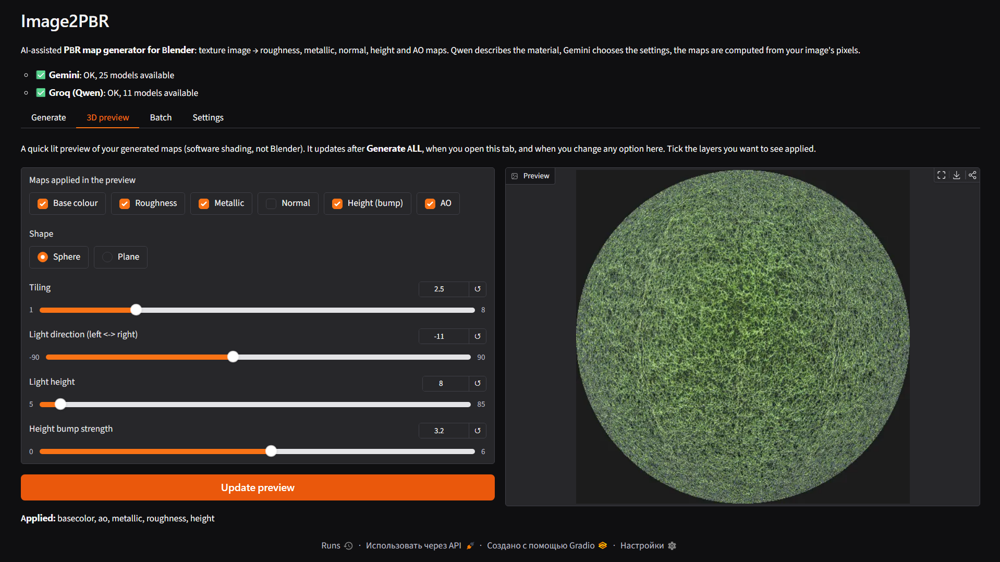
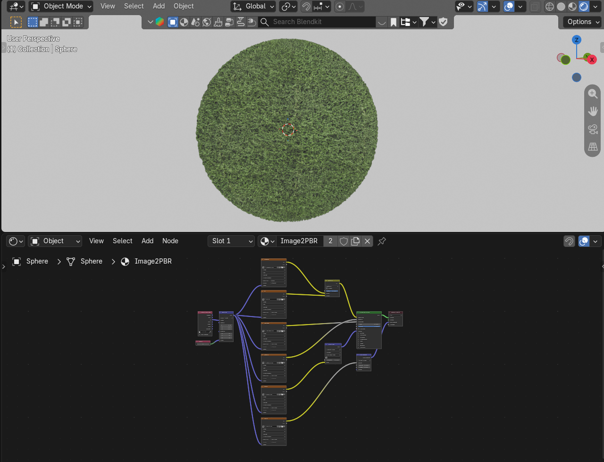

# Image2PBR

**AI-assisted PBR map generator for Blender.** Drop in a texture image and get matching
**roughness, metallic, normal, height and ambient-occlusion maps** - plus a ready-to-run Blender
script that builds the material for you.

> Most "image → PBR" tools paint maps with a neural network, which often invents patterns that don't
> belong to your texture. Image2PBR works differently: the AI only **chooses settings**, and every map is
> **computed from the pixels of your own image**, so the result always lines up with the picture.

<p align="center">
  
</p>

## Features

- **Qwen + Gemini pipeline** - Qwen (vision, via Groq) describes the material and what each colour is
  (rust, bare metal, wood, …); Gemini turns that description into precise generator settings.
- **5 maps:** roughness, metallic, normal (OpenGL), height (16-bit PNG), ambient occlusion.
- **~20 parameters per map**, all editable by hand with sliders: channel, blur, baked-light removal, CLAHE,
  levels, gamma, contrast, sharpen, per-colour region values, binarize/cleanup for metallic masks,
  multi-scale normal weights, AO radius/strength, and more.
- **Generate all + ZIP** - one click produces every selected map, `basecolor.png`, `params.json` and
  `blender_setup.py`.
- **Blender script** - builds a Principled BSDF material with all nodes wired (Non-Color maps, Normal Map
  node, Displacement, AO multiplied into base colour).
- **Seamless option** - make any texture tileable (variance-preserving cross-fade).
- **Real-time 3D viewer** - WebGL in your browser (no Blender needed): drag to rotate, wheel to zoom, sphere / plane / cube. Every map has its own **strength slider** (base colour, roughness, metallic, normal, AO, height as bump and as real displacement), plus light direction/height/intensity, environment light and tiling. Settings are remembered, *Save PNG* takes a screenshot, and a standalone `viewer.html` is offered for download.
- **One Gemini request for all maps** (cached per map, so re-runs cost nothing) and **your own named presets** (*My: name*, stored in `user_presets.json`).
- **Batch mode** - process a whole set of images into one ZIP.
- **Undo** per map, **presets** that work without AI, **dark theme**.
- **AI response cache** - identical requests don't burn your free-tier limits.
- **Model pickers** for Qwen/Gemini (lists are fetched from the APIs) and built-in key setup with
  error messages when a service isn't working.

### Example result

<p align="center">
  
</p>

## Quick start

Requires **Python 3.10+**.

**Windows:** double-click `run.bat` (creates a virtual environment on the first run, installs
dependencies, starts the app).

**Linux / macOS:** `./run.sh`

**Manually:**

```bash
python -m venv .venv
# Windows: .venv\Scripts\activate      Linux/macOS: source .venv/bin/activate
pip install -r requirements.txt
python app.py
```

The app opens in your browser at <http://127.0.0.1:7860>.

## API keys (free)

The AI features need two free keys. You can paste them in the app (**Settings** tab →
**Save & test keys**) - the app also tells you when a key is missing or a service isn't working.

| Service | What it does | Get a key |
|---|---|---|
| Google **Gemini** | chooses the generator settings | <https://aistudio.google.com/apikey> |
| **Groq** (Qwen vision) | describes the texture | <https://console.groq.com/keys> |

Keys are stored only in a local `.env` file (git-ignored) if you tick *Remember on this computer*.
You can also copy `.env.example` to `.env` and edit it yourself.

**No keys?** The app still works: use the presets and sliders.

<p align="center">
  
</p>

## How to use

1. Upload a texture. Pick the map you want to tune.
2. Press **⚡ Generate ALL selected maps** - or use *Auto for this map*, or the two step buttons
   (*Describe (Qwen)* → *Settings (Gemini)*). The description is editable; fix it if the AI got a colour wrong.
3. Fine-tune with the sliders (preview updates when you release a slider). **↩ Undo** steps back.
4. Check the **3D preview** tab.
5. Download the **ZIP**.

Tips:
- Textures with **baked shading** (vignette, shadows)? Raise *Remove baked lighting*.
- Metallic should usually be a clean mask: set *Binarize* close to 1 and tune the threshold.
- Want it to tile? Tick **Make seamless**. The ZIP then contains the seamless base colour.
- *Also send the image to Gemini* improves accuracy but sends your image to Google as well
  (on the free tier Google may use it to improve its products).

### 3D preview

<p align="center">
  
</p>

### In Blender

1. Extract the ZIP, open Blender → **Scripting** tab → **Open** `blender_setup.py` → **Run Script**.
2. If a mesh is active, the material is assigned to it. Adjust `TILING` / `DISPLACEMENT` at the top of the script.

Manual setup: load every map with **Color Space = Non-Color** (except the base colour), connect the normal
map through a **Normal Map** node (format: OpenGL, which is Blender's default).

<p align="center">
  
</p>

## How it works

```
 image ──► k-means palette ──► Qwen: "colour #2 is rust, #0 is bare steel, ..."
                                  │
                                  ▼
                      Gemini: JSON with settings
        (per-colour values + channel/contrast/blur/threshold/...)
                                  │
                                  ▼
   pixels of YOUR image ──► roughness / metallic / normal / height / AO
```

- **Detail** comes from the image itself (a chosen channel, cleaned and tone-mapped).
- **Regions** come from the palette: every colour gets its own value (e.g. rust → rough, bare metal → shiny)
  and the borders between regions are soft.
- Pixel-based parameters are defined for a 1024 px image and scale automatically, so the preview matches
  the full-size output.

## Free-tier limits

Free tiers are limited per minute/day and change over time; check your own limits at
<https://aistudio.google.com/rate-limit> and <https://console.groq.com/settings/limits>.
"Generate all" for 5 maps uses 1 Qwen + 5 Gemini requests (cached for identical inputs).

## Project layout

```
app.py                  entry point
image2pbr/
  pbr.py                map generation (palette, tone, roughness/metallic/normal/height/AO, seamless)
  ai.py                 Groq/Qwen + Gemini clients, key checks, cache, error classification
  ui.py                 Gradio interface
  viewer.py             interactive WebGL 3D viewer
  presets.py            built-in + user presets
  export.py             PNG/ZIP export and the Blender script
  settings.py           .env handling, model names
  samples.py            procedural test textures
tests/                  pytest suite (no network needed)
selftest.py             checks your keys and runs the full pipeline once
run.bat / run.sh        one-click launchers
```

## Development

```bash
pip install -r requirements.txt pytest
python -m pytest
python selftest.py            # with your keys: real end-to-end check
```

## Troubleshooting

| Problem | Fix |
|---|---|
| "no API key" / ❌ banner | Settings tab → paste keys → *Save & test keys* |
| "model not found" | Settings → *Refresh model lists* and pick another model |
| "rate limit (429)" | wait a minute; keep the cache enabled; use presets meanwhile |
| "cannot reach the server" | check internet/VPN; Groq or Google may be blocked in some regions |
| Metallic looks grey | set *Binarize* to 1 (it's a mask), or lower *Detail strength* |
| Normal is too noisy/flat | change *Blur*, *Bump strength* and the fine/medium/coarse weights |

## Privacy

Your image (downscaled to ≤1024 px) is sent to Groq for the description. It is sent to Gemini only if you
tick *Also send the image to Gemini*. API keys never leave your computer except in requests to their own
service. Nothing else is uploaded.

## License

MIT - see [LICENSE](LICENSE).


## Troubleshooting: Blender script

`Cannot read '...source.png'` means the script could not find the maps. Extract the **whole ZIP** (do not
run the script from inside the archive), keep `blender_setup.py` next to the PNG files, or set
`TEXTURE_DIR` at the top of the script to that folder. The script now searches several folders and
lists them in the error message; missing maps are skipped with a warning.
